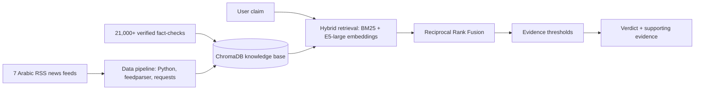

# 📰 Arabic Fake News Detection: A Hybrid RAG Fact-Verification System

> Graduation Project · Egypt University of Informatics · **Grade: A+**

A system that checks whether an Arabic news claim can be trusted, by retrieving evidence from a knowledge base of verified fact-checks and recent news.

---

## 🎯 The Problem
Fake news spreads fast in Arabic media, and manual fact-checking can't keep up. This project automatically finds evidence for or against a claim, even when the claim is **reworded**.

## 📊 Results
| Metric | Result |
|---|---|
| Retrieval precision@1 | **93.5%** |
| F1 score | **0.471 → 0.667** (after hybrid fusion + calibrated thresholds) |
| End-to-end accuracy | **97%** on 200 paraphrased test claims |

## ⚙️ How It Works


1. **Data collection:** a Python pipeline ingests **50,700+ news records** from **7 Arabic RSS feeds**.
2. **Knowledge base:** **21,000+ verified fact-checks** from Egyptian and pan-Arab sources, stored with the news records in **ChromaDB** (a two-part knowledge base: news and fact-checks).
3. **Hybrid retrieval:** combines **BM25** (exact keyword match) with **E5-large embeddings** (meaning-based search), merged using **Reciprocal Rank Fusion**.
4. **Verification:** calibrated **evidence thresholds** decide when the evidence is strong enough to support a verdict.

## 🛠️ Tech Stack
Python · RAG · ChromaDB (vector database) · BM25 · E5-large embeddings · Reciprocal Rank Fusion · scikit-learn · feedparser · requests


## 🚀 How to Run
```bash
git clone https://github.com/Russell219/arabic-fake-news-detection.git
cd arabic-fake-news-detection
pip install -r requirements.txt    # [check this file exists]
python [main_script.py]            # [replace with your entry point]
```

## 👥 Team
This was a team graduation project:

| Member | Role |
|---|---|
| **Russell Mohamed Tamer** | Data pipeline and RAG fact-verification system: collected 50,700+ news records from 7 Arabic RSS feeds, built the 21,000+ fact-check knowledge base in ChromaDB, and designed the hybrid retrieval (BM25 + E5-large with Reciprocal Rank Fusion) and evidence thresholds |
| **Sarah [last name]** | Machine learning model |
| **Youssef [last name]** | Cybersecurity |

## 📫 Contact
**Russell Mohamed Tamer** · [LinkedIn](https://www.linkedin.com/in/russell-tamer-a737a4276)# arabic-fake-news-detection
